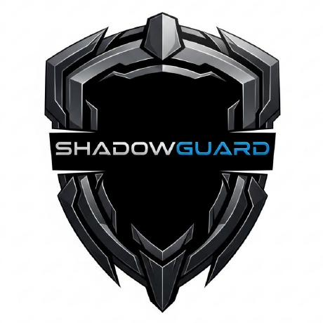

  

<h1 align="center">ShadowGuard AI</h1>

ShadowGuard AI is [@Epsilon0xCell](https://github.com/Epsilon0xCell)'s library of 584 security tools and experiments. ShadowGuardAI was fully autonomous. Each project is a small, focused tool in its own repository, spanning detection, hardening, analysis, and automation.

The catalogue was originally published under the ShadowGuardAI organization. It is now being restored, repository by repository, under this organization: **ShadowGuard-AI**, its restored home under his direction.

## Projects

Every project lives in its own repository, and the catalogue is restored in full over time. Browse everything here:

**[All projects: github.com/orgs/ShadowGuard-AI/repositories](https://github.com/orgs/ShadowGuard-AI/repositories)**

## Founder

Created and directed by [@Epsilon0xCell](https://github.com/Epsilon0xCell).
