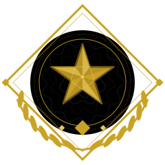
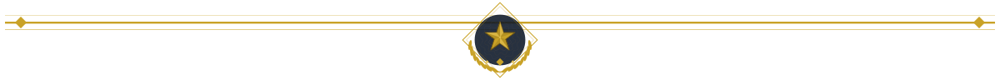
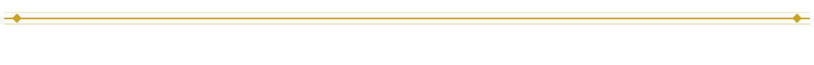
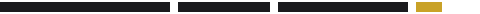
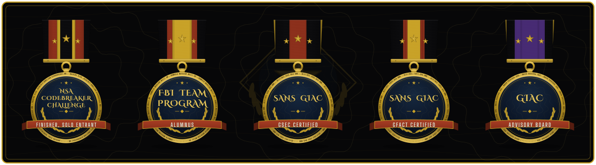
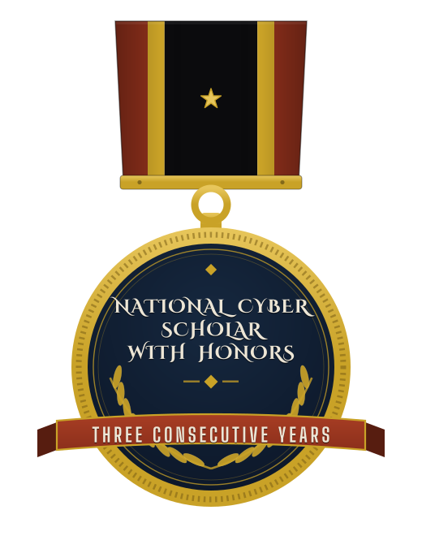
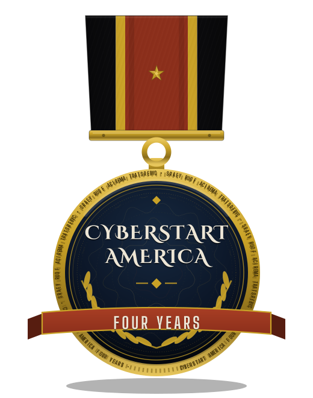
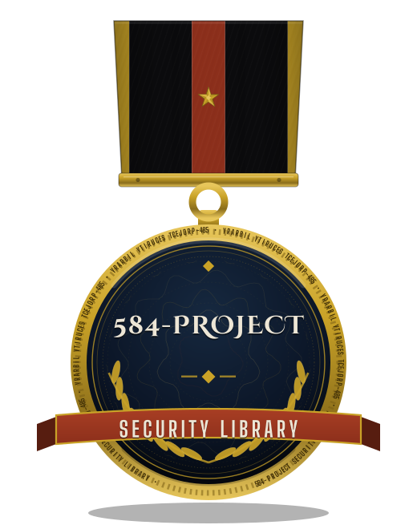
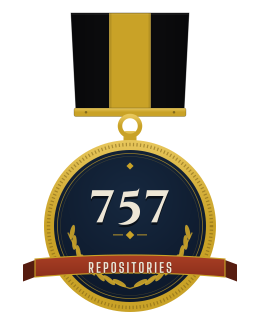

  

<h1 align="center">ShadowGuard AI</h1>

ShadowGuard AI is [@Epsilon0xCell](https://github.com/Epsilon0xCell)'s library of 584 security tools and experiments. ShadowGuardAI was fully autonomous. Each project is a small, focused tool in its own repository, spanning detection, hardening, analysis, and automation.

The catalogue was originally published under the ShadowGuardAI organization. It is now being restored, repository by repository, under this organization: **ShadowGuard-AI**, its restored home under his direction.

## Projects

Every project lives in its own repository, and the catalogue is restored in full over time. Browse everything here:

**[All projects: github.com/orgs/ShadowGuard-AI/repositories](https://github.com/orgs/ShadowGuard-AI/repositories)**

## Founder

Created and directed by Gavin Blacklock ([@Epsilon0xCell](https://github.com/Epsilon0xCell)).

## The Evidence

| Measure | Count |
|---|---|
| Projects in the library | 584 |
| Repositories in the fleet | 757 |
| Audited line by line | 754 |
| Live secrets found | 0 |

The library, in short: 584 open-source security projects, public and documented. I build the tooling, I test it against its own documentation, and I write down what I find.

## The Elite Row

Every claim here can be checked against the public record.

## The Record

   

